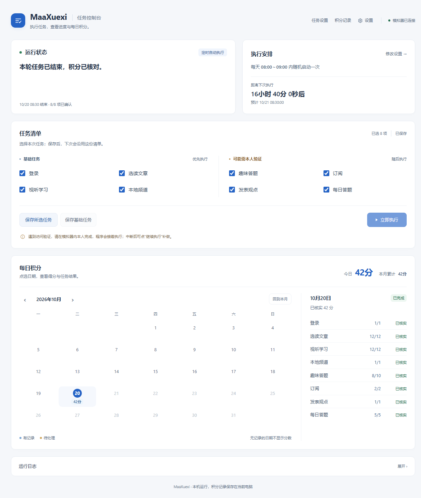

# MaaXuexi

基于 [MaaFramework](https://github.com/MaaXYZ/MaaFramework) 和 [上游 MaaXuexi](https://github.com/ravizhan/MaaXuexi) 的 Windows 本地任务控制台。通过 MuMu 模拟器操作学习强国，在浏览器里选择任务、查看实际积分、暂停或继续，并设置每日启动时间。

**先使用基础任务；需要答题时再配置 DeepSeek。访问验证仍须本人完成。** 程序会核对实际积分，已满分的项目自动跳过，不把点击成功当成任务完成。



截图使用演示数据，不代表每天能够获得相同积分。

## 快速开始

1. 准备 **Windows 10/11 64 位、Python 3.12 64 位、带 MuMuManager 或 mumu-cli 的 MuMu 模拟器**。在模拟器安装学习强国并本人登录。详细版本与环境说明见[安装指南](docs/installation.md)。
2. [下载源码 ZIP](https://github.com/Orangaigai/MaaXuexi/archive/refs/heads/main.zip)，解压到普通本地目录，例如 `D:\MaaXuexi`，不要直接在压缩包内运行。
3. 双击 **安装MaaXuexi.cmd**，按提示输入 MuMu 安装目录，例如 `D:\Apps\MuMuPlayer`。首次安装会下载锁定依赖；不会自动学习、调用模型或覆盖已有密钥。
4. 安装完成后双击 **启动MaaXuexi.cmd**，打开的控制台地址为 <http://127.0.0.1:8000/>。
5. 初次安装默认选择基础任务、关闭定时。确认选择后点击 **立即执行**。要保留选择，点击 **保存所选任务**。

遇到问题先看[常见问题](docs/troubleshooting.md)。安装脚本的界面提示目前为英文，逐步说明与参数示例均在[安装指南](docs/installation.md)。

## 可以做什么

| 功能 | 说明 |
| --- | --- |
| 基础任务 | 登录、选读文章、视听学习、本地频道；不调用 DeepSeek |
| 每日答题 | 选择、填空、点选填空；能从完整提示直接确定时先使用提示，否则按题型调用 DeepSeek |
| 趣味答题 | 识别平台当日提供的单人、双人或四人模式，处理答题、结算和返回 |
| 订阅 | 逐个操作后核分，记录订阅/取消次数，并清理程序新增关注 |
| 发表观点 | **新安装默认关闭**；启用后仅对科普生活内容阅读全文并生成、复核短评，属于账号公开发言 |
| 手动与定时 | 手动立即执行，或选择时间点/时间段；时间段每天随机选定一次 |
| 暂停与续做 | 中断后按原清单重新核分，补做未完成项目；正常验证恢复后自动接续 |
| 每日积分 | 按月查看已核实积分，点击日期看各项分数、状态及未完成原因；同日更新记录、不重复累加 |
| 历史积分导入 | 首次选择积分及明细、仅每日积分或从今天开始；完整明细先确认耗时和零 API 费用，双向核对后按日期合并 |
| 完成后关闭 | 保存积分后倒计时关闭本项目控制台、配置的模拟器实例和后台；可选择本次保持打开 |
| 窗口与通知 | 后台、置底、正常、置顶；本人处理时显示一次；独立桌面通知及定时打开控制台开关 |
| 本机自检 | 汇总设备、文件、密钥配置和计划状态，免费、只读，不启动任务 |

每项积分、上限、入口与验证要求以 App 当天显示为准。项目没有“永不封号”“每日满分”或“全程无需本人”的保证。随机时间和模拟点击不能保证免风控。

## 配置与使用

- **答题密钥**：打开“设置 → 答题服务”，点击“配置密钥”或“管理密钥”。没有密钥可看页面内四步教程。[DeepSeek 配置说明](docs/configuration.md#deepseek)
- **自动启动**：在“设置 → 执行与定时”选择“定时自动执行”，设置时间点或时间段并保存。电脑须开机、登录 Windows、未休眠且联网。[使用指南](docs/usage.md)
- **本人验证**：在模拟器完成真实验证，保留后续页面；程序观察到正常页面后继续。中断后在控制台点“继续执行”。
- **减少打扰**：右上角“设置”选择后台运行；需要本人处理时显示一次，点击其它窗口即可盖住。历史导入也可在设置中重新发起。[窗口与通知](docs/window-settings.md)
- **停止后台**：网页“中止任务”结束本轮；停止MaaXuexi.cmd 关闭本项目后台。仅关闭网页不会停止任务。
- **积分记录与收尾**：“设置 → 运行收尾”默认启用“完成后自动关闭”，完成后有30秒可选择保持打开。重新启动可查看月历；当天已完成时不额外启动模拟器，定时启动仍会正常准备设备。
- **公开发言**：请先了解范围、次数限制及实际行为，再自行启用。[观点与隐私配置](docs/configuration.md#公开发言)

DeepSeek 按量计费，连接验证也会产生一次小额调用；基础任务和环境自检不产生模型费用。API 密钥仅在本机按当前 Windows 用户加密保存，图文请求会发送至 DeepSeek 官方接口。[数据与费用说明](docs/configuration.md#数据与费用)

## 项目结构

```text
backend/       任务执行、识别、核分、模型与本地服务
page/          控制台、设置、密钥教程及本地样式
resource/      图片、OCR/检测模型与识别流程
scripts/       安装、启动、定时、自检及离线工具
config/        示例与源文件清单；实际配置和数据库不提交
tests/         离线回归及固定测试样本
docs/          安装、配置、使用、排错与开发文档
```

源码仓库不包含 `.venv`、API 密钥、账号登录态、个人数据库或运行日志。旧的本机逐轮验收笔记已归入本机恢复备份，公开文档描述当前用法；[更新记录](CHANGELOG.md)记录用户可见变化。

## 开发与反馈

请先阅读[贡献指南](CONTRIBUTING.md)、[开发说明](docs/development.md)和[安全说明](SECURITY.md)。提交问题时附版本、任务、复现步骤及已打码截图，勿附密钥、登录态或完整个人日志目录。

离线回归：

```powershell
.\.venv\Scripts\python.exe -m unittest discover -s tests -p "test_*.py" -q
.\.venv\Scripts\python.exe scripts\Check-Repository.py
```

这些命令不启动真实学习或付费模型测试。浏览器可用性、真实平台积分和本人验证需要另外验收，不能由离线测试结果替代。

## 来源与许可证

本项目基于 `ravizhan/MaaXuexi` v1.7.1 修改，沿用 [GNU AGPL-3.0](LICENSE)，保留上游来源与许可证。依赖和资源来源见[致谢与来源](ACKNOWLEDGEMENTS.md)。
